 

## About me

- I build native apps for **iPhone, iPad and Mac** at [@CoderZone](https://github.com/CoderZone)
- I turn everyday Xcode chores into small tools, like **devsim**
- I write Swift packages that stay **dependency-free** whenever they can
- Most at home in **SwiftUI**, dropping into UIKit and AppKit when it matters
- Some **Flutter & Dart** on the side

## Toolbox

## Featured projects

 

## Activity

